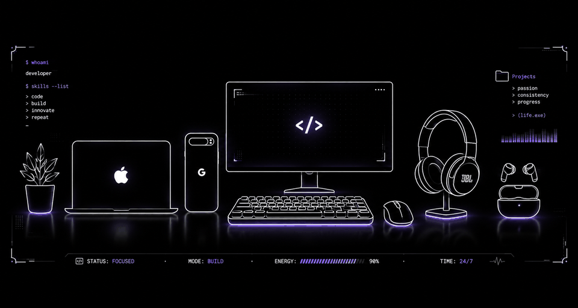

<!-- =========================================================
  Alexandre Wayss — GitHub Profile README
  Style: Apple-inspired futuristic / dark / red accent
========================================================= -->

<div align="center">



<br/>


<br/>

<a href="https://github.com/alexandre-wayss">
  
</a>

<a href="https://www.linkedin.com/in/alexandre-wayss-181330266/">
  
</a>

</div>

<br/>

---

## About Me

```swift
struct Developer {
    let name = "Alexandre Wayss"
    let role = "Software Developer"

    let education = [
        "Computer Science — UNIJUÍ, 5th semester",
        "Internet Computing Technician — CTISM, 2021–2023"
    ]

    let focus = [
        "Kotlin",
        "Software Development",
        "Backend Development",
        "Mobile Development"
    ]

    let currentlyLearning = [
        "Swift"
    ]

    let goal = "Internship or Junior Software Developer opportunity"
}
```

I am a Computer Science student focused on building a strong foundation in software development and modern engineering practices.

My current technical focus is **Kotlin**, while I am also expanding my knowledge into **Swift** and the Apple development ecosystem.

I enjoy learning how software is structured beyond the interface — from application logic and databases to tooling, development workflows, and maintainable code.

---

## Tech Stack

<div align="center">

### Languages


<br/><br/>

### Database


</div>

---

## Development Tools

<div align="center">


<br/><br/>


</div>

---

## Education

<table>
  <tr>
    <td width="50%" valign="top">
      <h3>Computer Science</h3>
      <p><strong>UNIJUÍ</strong></p>
      <p>Currently in the 5th semester.</p>
    </td>
    <td width="50%" valign="top">
      <h3>Internet Computing Technician</h3>
      <p><strong>CTISM</strong></p>
      <p>Technical education completed between 2021 and 2023.</p>
    </td>
  </tr>
</table>

---

## Current Focus

<div align="center">


</div>

<br/>

- Deepening my knowledge of **Kotlin**
- Learning **Swift**
- Improving software architecture and development fundamentals
- Practicing modern development workflows with **Git** and **Docker**
- Preparing for **Internship** and **Junior Software Developer** opportunities

---

## GitHub Analytics

<div align="center">


</div>

<br/>

<div align="center">


</div>

---

## Connect

<div align="center">

<a href="https://www.linkedin.com/in/alexandre-wayss-181330266/">
  
</a>

<a href="https://github.com/alexandre-wayss">
  
</a>

</div>

<br/>

---

<div align="center">


<sub>Designed with a clean, futuristic and minimal aesthetic.</sub>

</div>
